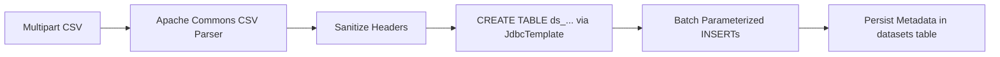
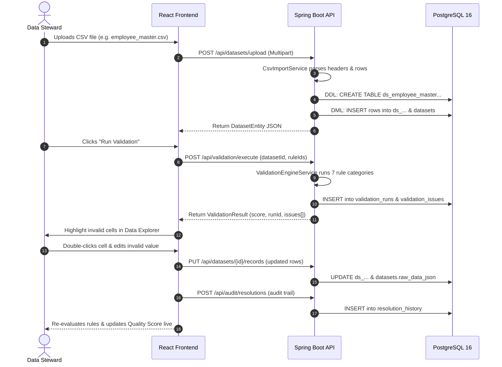

# 🛡️ SilentGuard — Technical Architecture & System Notes

> **Notion Documentation**: A comprehensive breakdown of the Frontend, Backend, and Database architecture in SilentGuard — explaining **what** each layer does and **how** it does it under the hood.

---

## 📌 Executive Summary

**SilentGuard** is an enterprise data quality and silent failure detection engine designed for tabular datasets (CSV pipelines, batch dispatches, data warehouse syncs). 

Traditional schema validators pass files as long as the columns exist and types match superficially. **SilentGuard detects "silent failures"** — records where data is technically valid UTF-8 text, but violates critical business constraints, completeness standards, referential integrity, range thresholds, or temporal sequences.

---

## 🏗️ 1. Architecture Map

```
┌────────────────────────────────────────────────────────────────────────┐
│                        FRONTEND (React 19 + Vite 8)                    │
│                                                                        │
│  [Dashboard]   [Data Explorer]   [Rule Configurator]  [Audit & History]│
│        │              │                  │                   │         │
│        └──────────────┼──────────────────┴───────────────────┘         │
│                       ▼                                                │
│         API Client (`src/services/api.ts`)                             │
│         Hybrid Fallback (`src/services/validationEngine.ts`)           │
└───────────────────────┬────────────────────────────────────────────────┘
                        │ HTTP / REST / Multipart (Port 8080)
                        ▼
┌────────────────────────────────────────────────────────────────────────┐
│                   BACKEND (Spring Boot 4 / Java 17)                    │
│                                                                        │
│  [DatasetController]  [ValidationController]  [RuleController]         │
│           │                     │                    │                 │
│           ▼                     ▼                    │                 │
│   CsvImportService     ValidationEngineService       │                 │
│   (Apache Commons CSV) (Deterministic Rules Engine)  │                 │
│           │                     │                    │                 │
│           └─────────────────────┼────────────────────┘                 │
│                                 ▼                                      │
│                 Spring Data JPA / JdbcTemplate                         │
└─────────────────────────────────┬──────────────────────────────────────┘
                                  │ HikariCP Connection Pool (Port 5432)
                                  ▼
┌────────────────────────────────────────────────────────────────────────┐
│                        DATABASE (PostgreSQL 16)                        │
│                                                                        │
│  Core Metadata Tables:           Dynamic Relational Tables:            │
│  - `datasets`                    - `ds_employee_master_roster_csv`     │
│  - `validation_rules`            - `ds_motherson_parts_batch...`       │
│  - `validation_runs`             - `ds_<uploaded_file_name>`           │
│  - `validation_issues`                                                 │
│  - `resolution_history`                                                │
└────────────────────────────────────────────────────────────────────────┘
```

---

## 🗄️ 2. The Database Layer (PostgreSQL 16)

### **What the Database Does**
1. **Stores System State:** Holds datasets, configurable validation rules, test execution runs, detected issues, and audit resolution history.
2. **Generates Dynamic CSV Tables:** For every uploaded file, PostgreSQL provisions a dedicated relational table (`ds_<sanitized_name>`) with individual columns matching the CSV headers.
3. **Preserves Auditability:** Retains an immutable trace of historical validation runs and manual issue resolutions made by data stewards.

---

### **How the Database Does It**

#### A. Core Relational Entities
The relational schema uses Spring Data JPA / Hibernate (`ddl-auto=update`):

| Table Name | Primary Key | Key Columns | Purpose |
| :--- | :--- | :--- | :--- |
| `datasets` | `dataset_id` (varchar) | `file_name`, `table_name`, `row_count`, `column_count`, `columns_json`, `raw_data_json`, `pipeline_type`, `source_system` | Metadata registry for all loaded or uploaded datasets. |
| `validation_rules` | `rule_id` (varchar) | `name`, `type`, `target_columns_json`, `parameters_json`, `severity`, `enabled`, `error_message` | Rule definitions specifying constraints and thresholds. |
| `validation_runs` | `run_id` (varchar) | `dataset_id`, `timestamp`, `total_rows`, `total_rules_applied`, `issues_count`, `quality_score`, `execution_time_ms` | Historical log of every validation job executed. |
| `validation_issues` | `issue_id` (varchar) | `run_id`, `dataset_id`, `rule_id`, `row_index`, `column_name`, `invalid_value`, `expected_condition`, `status` | Record-level violations found during validation. |
| `resolution_history`| `resolution_id` (varchar)| `issue_id`, `dataset_id`, `rule_id`, `action`, `original_value`, `resolved_value`, `resolved_by`, `timestamp` | Audit trail of remediation actions (auto-fix, override, waive). |

#### B. Dynamic CSV Table Provisioning
When a CSV is imported, `CsvImportService` executes dynamic DDL:
```sql
CREATE TABLE IF NOT EXISTS ds_motherson_parts_batch_dispatch_csv (
    id SERIAL PRIMARY KEY,
    batch_id TEXT,
    part_number TEXT,
    dispatch_date TEXT,
    quantity TEXT,
    ...
);
```
- **Why TEXT columns?** CSV transfers frequently contain polymorphic or malformed values (e.g., `"N/A"` in an integer field). Storing raw cells as `TEXT` prevents database ingest crashes, allowing the validation engine to safely isolate and report the errors.
- **Header Sanitization:** Column names are stripped of special characters (`[^a-zA-Z0-9_]`), lowercased, and appended with deduplication counters (`field_2`) if duplicate headers exist.

---

## ⚙️ 3. The Backend Layer (Spring Boot 4 / Java 17)

### **What the Backend Does**
1. **CSV Streaming & Ingestion:** Ingests large multipart CSV files (up to 50MB) and parses them without memory bloat using **Apache Commons CSV**.
2. **Deterministic Rule Engine:** Applies seven categories of deterministic data quality rules against dataset rows.
3. **Data Quality Scoring:** Calculates an aggregate quality score `(0.0 - 100.0%)` based on total rows, total checks, and severity weights.
4. **Data Stewardship & Auditing:** Receives row-level updates, applies auto-fixes, and logs audit resolutions.
5. **Database Seeding:** Automatically seeds standard enterprise rules (HR Ops & Motherson Automotive MES) on first boot via `DataInitializer`.

---

### **How the Backend Does It**

#### A. Ingestion Pipeline (`CsvImportService.java`)

- Uses `BufferedReader` and `StandardCharsets.UTF_8`.
- Builds parameterized batch inserts (`INSERT INTO ds_... VALUES (?, ?, ...)`) to prevent SQL injection.
- Serializes dataset rows and columns into JSON payloads (`columns_json`, `raw_data_json`) for fast frontend delivery.

#### B. The Validation Engine (`ValidationEngineService.java`)
The engine iterates over records and executes deterministic rule evaluations:

1. **`REQUIRED` / Completeness Rule:**
   - Evaluates: `val == null || val.trim().isEmpty() || val.equalsIgnoreCase("null") || val.equalsIgnoreCase("n/a")`.
2. **`UNIQUENESS` Rule:**
   - Builds composite keys using `Map<String, Integer> valueTracker`.
   - Flags row indices where occurrence count exceeds 1.
3. **`MIN_VALUE` / `MAX_VALUE` Range Rules:**
   - Safely parses string cells into `double`.
   - Flags values outside configured numerical boundaries.
4. **`FORMAT` / Regex Rules:**
   - Evaluates compiled `java.util.regex.Pattern` (e.g. Email RFC 5322, ISO Date `YYYY-MM-DD`, Alphanumeric IDs).
5. **`CROSS_FIELD` Comparison Rules:**
   - Extracts two columns per record (e.g., `delivery_date` and `manufacturing_date`).
   - Parses dates into `java.time.LocalDate` and checks conditional operators (`>=`, `<=`, `>`, `<`).
6. **`REFERENTIAL_INTEGRITY` Catalog Rule:**
   - Verifies foreign keys against approved enterprise dictionaries (e.g. `['DEPT-ENG', 'DEPT-HR', 'DEPT-SALES']`).
7. **`SCHEMA_DRIFT` Rule:**
   - Verifies whether configured rules target columns that are missing from the uploaded CSV schema.

#### C. Quality Score Algorithm
$$QualityScore = \max\left(0, 100 - \frac{WeightedViolations}{TotalRows \times ActiveRules} \times 100\right)$$
- Critical violations apply a higher penalty multiplier than Warnings or Info notices.

---

## 💻 4. The Frontend Layer (React 19 + TypeScript + Tailwind CSS)

### **What the Frontend Does**
1. **Executive Quality Dashboard:** Displays pipeline health, overall quality score gauges, violation distributions, and severity counters.
2. **Interactive Data Grid (`DataExplorerView`):**
   - High-density spreadsheet rendering tabular data.
   - Highlights violating cells in real-time with color-coded severity tags (Critical = Red, Warning = Yellow, Info = Blue).
   - In-place cell editing: Users can edit invalid values directly in the grid.
3. **Rule Configurator:** UI for enabling, disabling, editing, or authoring custom regex, boundary, and uniqueness rules.
4. **Remediation Drawer:** Step-by-step resolution workflow: Auto-fix formatting, apply suggested overrides, or mark exceptions with audit notes.
5. **Contextual Disambiguator:** Evaluates how ambiguous polymorphic values (e.g. string `"120"`) behave under different semantic types (Salary vs. Dept ID vs. Quantity).

---

### **How the Frontend Does It**

#### A. Hybrid Client-Server Architecture
The frontend features a **dual-mode engine**:
- **Connected Mode (PostgreSQL + Spring Boot):** Communicates with `http://localhost:8080/api` via `fetch` requests in `src/services/api.ts`.
- **Client Fallback Engine:** If the backend is unreachable or local demonstration is needed, `src/services/validationEngine.ts` executes an identical TypeScript-based rule engine directly in the browser.

#### B. Component Breakdown

| Component | Key Role | Tech Used |
| :--- | :--- | :--- |
| `Navbar.tsx` | Dataset switcher, active pipeline stats, backend connection indicator (`🟢 PostgreSQL 16 Connected` / `🟡 Client-Side Fallback`). | React State, Lucide Icons |
| `DashboardView.tsx` | Metric cards (Total Rows, Issues, Quality Score), issue breakdown by rule category, and dataset summary. | Lucide Icons, CSS Grid |
| `DataExplorerView.tsx` | Spreadsheet view with cell validation highlighting, filter by issue severity, column search, and inline record editing. | React Hooks, Memoization |
| `RuleConfiguratorView.tsx` | Visual rule creator with parameter inputs (min, max, regex, catalog lists) and preset loaders (HR, Automotive, FinTech). | Reactive forms, LocalStorage |
| `IssueResolutionDrawer.tsx` | Slide-out panel for resolving selected errors, proposing regex-based fixes, and recording steward audit reasons. | Motion animations, Slide-overs |
| `UploadModal.tsx` | Drag-and-drop CSV file uploader with pipeline tags, multipart upload dispatcher, and schema preview. | HTML5 File API, FormData |

---

## 🔄 5. End-to-End Data Lifecycle Walkthrough



---

## 📋 6. Key Technical Takeaways

1. **Deterministic Silent Failure Trapping:** Unlike generic data validators that crash on dirty data, SilentGuard digests malformed cells into text-based staging tables, applying deterministic rules to pinpoint exact row and column coordinates.
2. **Resilient Dual Engine:** If the Java/PostgreSQL environment is ever offline, the React application seamlessly falls back to its isomorphic browser engine without blocking the user.
3. **Data Stewardship & Audit Integrity:** Every manual change or auto-fix produces a non-destructive audit trail in `resolution_history` before updating the dynamic database table.

---

## 👥 7. Team Member Responsibilities & Presentation Preparation Guide

> **Presentation Readiness Matrix**: This section details the assigned tasks and **extra newly added functionalities** for each team member. Each member must master their specific layer, understand how it interfaces with the others, and be prepared to present their live demo walkthrough and answer technical questions.

---

### 👤 Member 1: Frontend Lead — UI/UX & Interactive Data Stewardship
* **Functional Scope:** React 19 Frontend Architecture, Interactive Grid, Dynamic Modals & Remediation Workflows
* **Primary Source Files:** `src/App.tsx`, `src/components/Navbar.tsx`, `src/components/DataExplorerView.tsx`, `src/components/AddColumnModal.tsx`, `src/components/DuplicateColumnResolverModal.tsx`, `src/components/AutoFixVerificationModal.tsx`, `src/components/ContextualDisambiguatorModal.tsx`

#### 📋 Core Existing Responsibilities
1. Executive Quality Dashboard: Overall quality score gauges, violation distributions, and severity counters.
2. Interactive Spreadsheet Grid (`DataExplorerView`): Cell-level error highlighting, severity filtering, search, and inline cell editing.
3. Remediation Drawer (`IssueResolutionDrawer`): Single-issue override and remediation with audit trail capture.

#### ⚡ Extra Assigned Functionalities to Learn & Master (New)
1. **Dynamic Schema Extension Modal (`AddColumnModal.tsx`):**
   - Enables users to introduce new schema attributes directly into existing datasets without re-uploading.
   - **Smart Column Type Detection:** Auto-classifies new columns as `STRING`, `NUMBER`, `EMAIL`, `DATE`, `BOOLEAN`, `ALLOWED_VALUES`, `IDENTIFIER`, or `MULTI_VALUED`.
   - **Multi-Valued Delimited Support:** Handles multi-value fields (e.g. `skills`, `certifications`, `tags`, `phone_numbers`) with configurable delimiters (`,`, `;`, `|`).
   - Generates matching data quality rules on the fly and immediately attaches them to the active dataset.
2. **Duplicate Header Resolver (`DuplicateColumnResolverModal.tsx`):**
   - Automatically intercepts uploaded CSV files having identical header names across columns (e.g. duplicate `id` or `status` columns).
   - Allows users to rename colliding headers, merge attributes, or disambiguate before database table generation.
3. **Automated Fix Verification Preview (`AutoFixVerificationModal.tsx`):**
   - Provides a side-by-side visual diff modal before auto-fixes are committed to PostgreSQL.
   - Computes before-and-after values for common errors (e.g. sequential ID allocation, email format normalization, currency cleanup).
   - Allows batch acceptance or selective rejection of proposed fixes.
4. **Categorized Dataset Navigation (`Navbar.tsx`):**
   - Two distinct `<optgroup>` categories: **✨ Enterprise Presets** (`HR & Employee Master`, `Motherson Automotive Parts`, `Financial Ledger & Orders`) and **📂 Database & Uploaded Files**.
   - Preserves active selection in `localStorage` and smoothly cascades dataset changes down to the validation engine.
5. **Contextual Disambiguator UI (`ContextualDisambiguatorModal.tsx`):**
   - Explains how ambiguous values (e.g. string `"120"`) evaluate against multiple semantic domains (Department ID vs. Salary vs. Quantity).

#### 🎤 Presentation Talking Points & Demo Sequence
- **Demo Step 1:** Open the dataset selector in the Navbar to show the structured grouping of Enterprise Presets vs uploaded files.
- **Demo Step 2:** Navigate to Data Explorer, open the `Add Column` modal, define a multi-valued attribute (e.g. `certifications` with `;` delimiter), and demonstrate live schema generation.
- **Demo Step 3:** Trigger the Auto-Fix Verification modal to highlight how human-in-the-loop validation prevents unintended data corruption.
- **Key Technical Answer:** *"Why React 19? We utilize modern hooks, optimistic state updates for instant cell editing, and memoized tabular rendering to support 25,000+ records smoothly."*

---

### 👤 Member 2: Backend Engineer — API Services & Distributed Batch Processing
* **Functional Scope:** Spring Boot 4 REST API, Apache Commons CSV Streaming, Distributed Chunk Partitioning & Database Transaction Management
* **Primary Source Files:** `DatasetController.java`, `SpringBatchPartitioningService.java`, `AuditController.java`, `HealthController.java`, `CsvImportService.java`

#### 📋 Core Existing Responsibilities
1. RESTful API Endpoints: Ingestion (`/api/datasets/upload`), rules management (`/api/rules`), and validation execution (`/api/validation/execute`).
2. Apache Commons CSV Streaming: Memory-safe parsing of multipart CSV files.
3. Health check controller and database connectivity monitoring.

#### ⚡ Extra Assigned Functionalities to Learn & Master (New)
1. **High-Throughput Chunk Partitioning Service (`SpringBatchPartitioningService.java`):**
   - Built to handle multi-gigabyte or millions-of-rows enterprise transfers without causing Java heap `OutOfMemoryError`.
   - **Chunk-Oriented Processing:** Streams records in configurable memory-bounded chunks (e.g. 5,000 records per chunk) with constant O(1) memory consumption.
   - **Range Partitioning & Parallel Workers:** Divides massive datasets across a pool of parallel worker threads (`DEFAULT_PARTITIONS = 4`).
   - **Bulk JDBC Batch Updates:** Binds and executes parameter batches in single round-trips to PostgreSQL via `JdbcTemplate.batchUpdate`.
   - **Skip & Fault Tolerance:** Isolates malformed lines or unparseable delimiters without aborting the entire pipeline execution.
2. **Dedicated Partitioned Batch Endpoint (`POST /api/datasets/batch-process`):**
   - Accepts parameters for file, `partitions`, and `chunkSize`.
   - Computes throughput metrics: `totalRecords`, `totalChunks`, `executionTimeMs`, `throughputRecordsPerSec`, and `skippedDefectsCount`.
3. **Full Audit History CRUD Endpoints (`AuditController.java`):**
   - Added update (`PUT /api/audit/resolutions/{id}`) and delete (`DELETE /api/audit/resolutions/{id}`) endpoints.
   - Enables data stewards to maintain, edit, or retract audit notes with automated timestamping (`updatedAt`).
4. **Dataset Duplicate Prevention & In-Place Record Sync:**
   - Cleans up historical duplicate records on ingestion and dynamically updates row arrays (`PUT /api/datasets/{id}/records`) for instant spreadsheet cell edits.

#### 🎤 Presentation Talking Points & Demo Sequence
- **Demo Step 1:** Walk through the `/api/datasets/batch-process` endpoint and explain chunk-oriented processing vs traditional bulk loading.
- **Demo Step 2:** Explain the thread pool sizing (`Math.max(2, availableProcessors)`) and how partitions prevent database connection exhaustion.
- **Demo Step 3:** Showcase the audit endpoint handling resolution logs and persisting remediation trails in PostgreSQL.
- **Key Technical Answer:** *"Traditional APIs crash when processing 500MB CSV files because they load everything into memory. Our Spring Batch Partitioning Service streams 5,000-row chunks in parallel, guaranteeing constant O(1) memory overhead and sub-second chunk commit times."*

---

### 👤 Member 3: Data Quality Specialist — Deterministic Rule Engine & Scoring Algorithms
* **Functional Scope:** Validation Rules Architecture, Continuous Health Scoring, Dual-Engine Client/Server Parity
* **Primary Source Files:** `ValidationEngineService.java`, `src/services/validationEngine.ts`, `src/data/mockDatasets.ts`, `src/services/semanticDisambiguator.ts`

#### 📋 Core Existing Responsibilities
1. Seven Core Deterministic Rule Types: `REQUIRED`, `UNIQUE`, `MIN_VALUE`, `MAX_VALUE`, `FORMAT`, `CROSS_FIELD`, and `REFERENTIAL_INTEGRITY`.
2. Error categorizations: Critical, Error, Warning, and Info severity levels.
3. Dual-engine client fallback executing validation directly in browser if backend is disconnected.

#### ⚡ Extra Assigned Functionalities to Learn & Master (New)
1. **Graduated Continuous Health Score Algorithm:**
   - Replaced simplistic penalties that swung wildly to 0% or 100% with a graduated continuous scoring formula:
     $$\text{PassRatio} = \frac{\text{PassedRecords}}{\text{TotalRecords}}$$
     $$\text{WeightedDefects} = (\text{Critical} \times 2.5) + (\text{Error} \times 1.0) + (\text{Warning} \times 0.2)$$
     $$\text{DefectDensity} = \frac{\text{WeightedDefects}}{\text{TotalRecords}}$$
     $$\text{DensityDeduction} = \min(30.0, \text{DefectDensity} \times 20.0)$$
     $$\text{HealthScore} = \text{round}(\text{PassRatio} \times (100.0 - \text{DensityDeduction}))$$
   - Perfectly handles datasets with partial errors, ensuring scores accurately reflect overall batch health (e.g. 85% clean records with 2 minor warnings does not drop to 0%).
2. **`CHECK_CONSTRAINT` Rule Implementation:**
   - Evaluates conditional expressions and multi-token format standards across both Java backend and TypeScript client.
3. **Multi-Valued Attribute Evaluation:**
   - Parses delimited cells (e.g. `"Java, Python, C++"`) and verifies that each sub-token conforms to data dictionaries and format standards.
4. **Contextual Semantic Disambiguator:**
   - Evaluates values like `"120"` and classifies verdict as `VALID`, `INVALID`, `SUSPICIOUS`, or `UNMAPPED` based on column domain namespace.
5. **Full Parity Between Java & TypeScript Engines:**
   - Maintained identical rule evaluation semantics in `ValidationEngineService.java` and `validationEngine.ts` to ensure seamless offline demonstrations.

#### 🎤 Presentation Talking Points & Demo Sequence
- **Demo Step 1:** Explain why generic JSON schema validators fail on silent defects (e.g. negative salaries, dispatch date prior to manufacturing date).
- **Demo Step 2:** Demonstrate the graduated health score calculation and how weighted defects prevent binary 0/100 swings.
- **Demo Step 3:** Present the Contextual Value Inspector: type `120` and demonstrate how it is valid for department ID but invalid for a binary status or unit price.
- **Key Technical Answer:** *"Silent failure detection requires deterministic semantic checks. A cell containing '-5000' is valid UTF-8 and valid integer, but violates business boundaries. Our engine traps the defect at row and column coordinate before downstream ETL ingestion."*

---

### 👤 Member 4: Database Architect — PostgreSQL Relational Modeling & Schema Dynamics
* **Functional Scope:** PostgreSQL 16 Persistence, Dynamic Staging Tables, Schema Evolution & Seed Datasets
* **Primary Source Files:** `backend/src/main/resources/application.properties`, `DataInitializer.java`, `DatasetEntity.java`, `ValidationRuleEntity.java`, `ValidationRunEntity.java`, `ResolutionHistoryEntity.java`

#### 📋 Core Existing Responsibilities
1. Core Entity Relational Schema: `datasets`, `validation_rules`, `validation_runs`, `validation_issues`, and `resolution_history`.
2. Dynamic Table Generation (`ds_*`) via parameterized DDL and DML.
3. PostgreSQL connection pooling via HikariCP.

#### ⚡ Extra Assigned Functionalities to Learn & Master (New)
1. **Dynamic Staging Table Design Philosophy:**
   - Why raw dynamic table columns are provisioned as `TEXT`: Dirty enterprise transfers frequently contain malformed data types (e.g., `"N/A"` or `"TBD"` in numeric columns). Storing cells as `TEXT` in dynamic staging tables (`ds_<filename>`) guarantees ingest never crashes, allowing the engine to isolate, flag, and remediate errors deterministically.
2. **Full Tri-Preset Database Seeding Pipeline (`DataInitializer.java`):**
   - Automatically provisions and runs initial validation on all three standard enterprise presets on application boot:
     - `employee_master_roster.csv` (HR Ops sync with missing emails, negative salary, out-of-range department ID).
     - `motherson_parts_batch_dispatch.csv` (Automotive manufacturing MES with supplier codes, chronologically inverted delivery dates, and negative quantities).
     - `financial_orders.csv` (Payment ledger with currency validations, negative amounts, and duplicate transaction IDs).
3. **Database Integrity & Historical Duplicate Cleanup:**
   - Implemented automated deduplication in `DatasetController` and `CsvImportService` to prevent redundant dataset entries while preserving historical validation runs.
4. **Non-Destructive Remediation Audit Trail (`resolution_history`):**
   - Maintains an immutable audit trace of every steward fix (who fixed it, when, original value, resolved value, action type).

#### 🎤 Presentation Talking Points & Demo Sequence
- **Demo Step 1:** Show PostgreSQL tables in `psql` or pgAdmin: display both core metadata tables and the dynamic `ds_*` staging tables.
- **Demo Step 2:** Highlight how `DataInitializer` seeds 21 validation rules and all 3 domain datasets automatically on boot.
- **Demo Step 3:** Show how an inline cell correction in the UI updates the dynamic table row and logs an immutable entry in `resolution_history`.
- **Key Technical Answer:** *"By decoupling raw ingest storage using TEXT staging tables from deterministic rule validation, SilentGuard ensures zero-downtime ETL pipelines. Data is captured 100% of the time, flagged with surgical precision, and remediated transparently."*

---

## 🎯 8. Team Presentation Checklist & Slide Allocation

| Slide / Section | Presenter | Key Focus & Visual Asset |
| :--- | :--- | :--- |
| **1. Executive Problem & Architecture** | **Member 1** (Frontend Lead) | The Silent Failure Problem, System Architecture Diagram, Navbar & Presets. |
| **2. High-Throughput Ingestion & Batching** | **Member 2** (Backend Engineer) | Spring Batch Partitioning Service, Chunk-oriented processing, O(1) memory usage. |
| **3. Deterministic Rules & Health Scoring** | **Member 3** (Data Quality Specialist) | 7 Rule Categories, Graduated Health Score Formula, Contextual Disambiguator. |
| **4. Dynamic Database Staging & Auditability**| **Member 4** (Database Architect) | PostgreSQL Dynamic Tables (`ds_*`), Schema seeding, Audit Resolution History. |
| **5. Live End-to-End Stewardship Demo** | **All Team Members** | Upload dirty CSV -> View flagged cells -> Auto-fix preview -> Persist to DB -> Export audit trail. |
