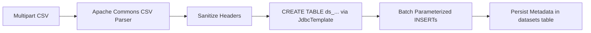
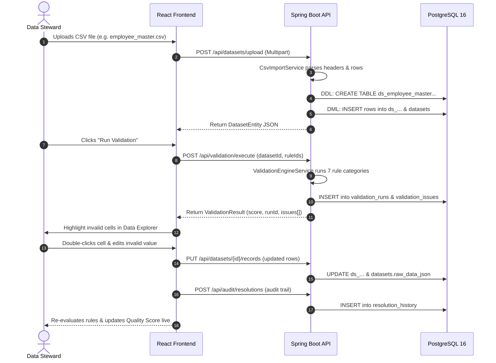
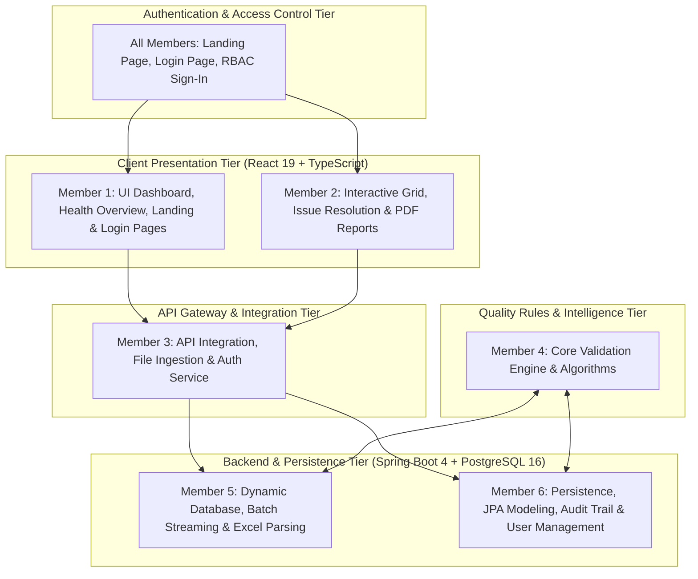

# 🛡️ SilentGuard — Technical Architecture & System Notes

> **Notion Documentation**: A comprehensive breakdown of the Frontend, Backend, and Database architecture in SilentGuard — explaining **what** each layer does and **how** it does it under the hood.

> [!NOTE]
> **Phase 2 Update (November 2026):** Extended with Login & Landing Pages, Excel (XLSX) upload/download support, PDF Audit Reports, Role-Based Access Control (RBAC) with employee accounts, simplified Navbar, user-scoped Run History with admin deletion, and consistent Motherson branding.

---

## 📌 Executive Summary

**SilentGuard** is an enterprise data quality and silent failure detection engine designed for tabular datasets (CSV pipelines, batch dispatches, data warehouse syncs). 

Traditional schema validators pass files as long as the columns exist and types match superficially. **SilentGuard detects "silent failures"** — records where data is technically valid UTF-8 text, but violates critical business constraints, completeness standards, referential integrity, range thresholds, or temporal sequences.

---

## 🏗️ 1. Architecture Map

```
┌────────────────────────────────────────────────────────────────────────┐
│                        FRONTEND (React 19 + Vite 8)                    │
│                                                                        │
│  [Landing Page]  [Login Page]  [Auth Service / RBAC]                   │
│        │              │                │                               │
│        └──────────────┼────────────────┘                               │
│                       ▼                                                │
│  [Dashboard]   [Data Explorer]   [Rule Configurator]  [Audit & History]│
│  [Run History] [User Management] [PDF Reports]  [Excel/CSV Ingestion] │
│        │              │                  │                   │         │
│        └──────────────┼──────────────────┴───────────────────┘         │
│                       ▼                                                │
│         API Client (`src/services/api.ts`)                             │
│         Auth Service (`src/services/authService.ts`)                   │
│         Hybrid Fallback (`src/services/validationEngine.ts`)           │
└───────────────────────┬────────────────────────────────────────────────┘
                        │ HTTP / REST / Multipart (Port 8080)
                        ▼
┌────────────────────────────────────────────────────────────────────────┐
│                   BACKEND (Spring Boot 4 / Java 17)                    │
│                                                                        │
│  [DatasetController]  [ValidationController]  [RuleController]         │
│           │                     │                    │                 │
│           ▼                     ▼                    │                 │
│   CsvImportService     ValidationEngineService       │                 │
│   (Apache Commons CSV) (Deterministic Rules Engine)  │                 │
│           │                     │                    │                 │
│           └─────────────────────┼────────────────────┘                 │
│                                 ▼                                      │
│                 Spring Data JPA / JdbcTemplate                         │
└─────────────────────────────────┬──────────────────────────────────────┘
                                  │ HikariCP Connection Pool (Port 5432)
                                  ▼
┌────────────────────────────────────────────────────────────────────────┐
│                        DATABASE (PostgreSQL 16)                        │
│                                                                        │
│  Core Metadata Tables:           Dynamic Relational Tables:            │
│  - `datasets`                    - `ds_employee_master_roster_csv`     │
│  - `validation_rules`            - `ds_motherson_parts_batch...`       │
│  - `validation_runs`             - `ds_<uploaded_file_name>`           │
│  - `validation_issues`                                                 │
│  - `resolution_history`                                                │
└────────────────────────────────────────────────────────────────────────┘
```

---

## 🗄️ 2. The Database Layer (PostgreSQL 16)

### **What the Database Does**
1. **Stores System State:** Holds datasets, configurable validation rules, test execution runs, detected issues, and audit resolution history.
2. **Generates Dynamic CSV Tables:** For every uploaded file, PostgreSQL provisions a dedicated relational table (`ds_<sanitized_name>`) with individual columns matching the CSV headers.
3. **Preserves Auditability:** Retains an immutable trace of historical validation runs and manual issue resolutions made by data stewards.

---

### **How the Database Does It**

#### A. Core Relational Entities
The relational schema uses Spring Data JPA / Hibernate (`ddl-auto=update`):

| Table Name | Primary Key | Key Columns | Purpose |
| :--- | :--- | :--- | :--- |
| `datasets` | `dataset_id` (varchar) | `file_name`, `table_name`, `row_count`, `column_count`, `columns_json`, `raw_data_json`, `pipeline_type`, `source_system` | Metadata registry for all loaded or uploaded datasets. |
| `validation_rules` | `rule_id` (varchar) | `name`, `type`, `target_columns_json`, `parameters_json`, `severity`, `enabled`, `error_message` | Rule definitions specifying constraints and thresholds. |
| `validation_runs` | `run_id` (varchar) | `dataset_id`, `timestamp`, `total_rows`, `total_rules_applied`, `issues_count`, `quality_score`, `execution_time_ms` | Historical log of every validation job executed. |
| `validation_issues` | `issue_id` (varchar) | `run_id`, `dataset_id`, `rule_id`, `row_index`, `column_name`, `invalid_value`, `expected_condition`, `status` | Record-level violations found during validation. |
| `resolution_history`| `resolution_id` (varchar)| `issue_id`, `dataset_id`, `rule_id`, `action`, `original_value`, `resolved_value`, `resolved_by`, `timestamp` | Audit trail of remediation actions (auto-fix, override, waive). |

#### B. Dynamic CSV Table Provisioning
When a CSV is imported, `CsvImportService` executes dynamic DDL:
```sql
CREATE TABLE IF NOT EXISTS ds_motherson_parts_batch_dispatch_csv (
    id SERIAL PRIMARY KEY,
    batch_id TEXT,
    part_number TEXT,
    dispatch_date TEXT,
    quantity TEXT,
    ...
);
```
- **Why TEXT columns?** CSV transfers frequently contain polymorphic or malformed values (e.g., `"N/A"` in an integer field). Storing raw cells as `TEXT` prevents database ingest crashes, allowing the validation engine to safely isolate and report the errors.
- **Header Sanitization:** Column names are stripped of special characters (`[^a-zA-Z0-9_]`), lowercased, and appended with deduplication counters (`field_2`) if duplicate headers exist.

---

## ⚙️ 3. The Backend Layer (Spring Boot 4 / Java 17)

### **What the Backend Does**
1. **CSV Streaming & Ingestion:** Ingests large multipart CSV files (up to 50MB) and parses them without memory bloat using **Apache Commons CSV**.
2. **Deterministic Rule Engine:** Applies seven categories of deterministic data quality rules against dataset rows.
3. **Data Quality Scoring:** Calculates an aggregate quality score `(0.0 - 100.0%)` based on total rows, total checks, and severity weights.
4. **Data Stewardship & Auditing:** Receives row-level updates, applies auto-fixes, and logs audit resolutions.
5. **Database Seeding:** Automatically seeds standard enterprise rules (HR Ops & Motherson Automotive MES) on first boot via `DataInitializer`.

---

### **How the Backend Does It**

#### A. Ingestion Pipeline (`CsvImportService.java`)

- Uses `BufferedReader` and `StandardCharsets.UTF_8`.
- Builds parameterized batch inserts (`INSERT INTO ds_... VALUES (?, ?, ...)`) to prevent SQL injection.
- Serializes dataset rows and columns into JSON payloads (`columns_json`, `raw_data_json`) for fast frontend delivery.

#### B. The Validation Engine (`ValidationEngineService.java`)
The engine iterates over records and executes deterministic rule evaluations:

1. **`REQUIRED` / Completeness Rule:**
   - Evaluates: `val == null || val.trim().isEmpty() || val.equalsIgnoreCase("null") || val.equalsIgnoreCase("n/a")`.
2. **`UNIQUENESS` Rule:**
   - Builds composite keys using `Map<String, Integer> valueTracker`.
   - Flags row indices where occurrence count exceeds 1.
3. **`MIN_VALUE` / `MAX_VALUE` Range Rules:**
   - Safely parses string cells into `double`.
   - Flags values outside configured numerical boundaries.
4. **`FORMAT` / Regex Rules:**
   - Evaluates compiled `java.util.regex.Pattern` (e.g. Email RFC 5322, ISO Date `YYYY-MM-DD`, Alphanumeric IDs).
5. **`CROSS_FIELD` Comparison Rules:**
   - Extracts two columns per record (e.g., `delivery_date` and `manufacturing_date`).
   - Parses dates into `java.time.LocalDate` and checks conditional operators (`>=`, `<=`, `>`, `<`).
6. **`REFERENTIAL_INTEGRITY` Catalog Rule:**
   - Verifies foreign keys against approved enterprise dictionaries (e.g. `['DEPT-ENG', 'DEPT-HR', 'DEPT-SALES']`).
7. **`SCHEMA_DRIFT` Rule:**
   - Verifies whether configured rules target columns that are missing from the uploaded CSV schema.

#### C. Quality Score Algorithm
$$QualityScore = \max\left(0, 100 - \frac{WeightedViolations}{TotalRows \times ActiveRules} \times 100\right)$$
- Critical violations apply a higher penalty multiplier than Warnings or Info notices.

---

## 💻 4. The Frontend Layer (React 19 + TypeScript + Tailwind CSS)

### **What the Frontend Does**
1. **Executive Quality Dashboard:** Displays pipeline health, overall quality score gauges, violation distributions, and severity counters.
2. **Interactive Data Grid (`DataExplorerView`):**
   - High-density spreadsheet rendering tabular data.
   - Highlights violating cells in real-time with color-coded severity tags (Critical = Red, Warning = Yellow, Info = Blue).
   - In-place cell editing: Users can edit invalid values directly in the grid.
3. **Rule Configurator:** UI for enabling, disabling, editing, or authoring custom regex, boundary, and uniqueness rules.
4. **Remediation Drawer:** Step-by-step resolution workflow: Auto-fix formatting, apply suggested overrides, or mark exceptions with audit notes.
5. **Contextual Disambiguator:** Evaluates how ambiguous polymorphic values (e.g. string `"120"`) behave under different semantic types (Salary vs. Dept ID vs. Quantity).

---

### **How the Frontend Does It**

#### A. Hybrid Client-Server Architecture
The frontend features a **dual-mode engine**:
- **Connected Mode (PostgreSQL + Spring Boot):** Communicates with `http://localhost:8080/api` via `fetch` requests in `src/services/api.ts`.
- **Client Fallback Engine:** If the backend is unreachable or local demonstration is needed, `src/services/validationEngine.ts` executes an identical TypeScript-based rule engine directly in the browser.

#### B. Component Breakdown

| Component | Key Role | Tech Used |
| :--- | :--- | :--- |
| `Navbar.tsx` | Dataset switcher, active pipeline stats, backend connection indicator (`🟢 PostgreSQL 16 Connected` / `🟡 Client-Side Fallback`). | React State, Lucide Icons |
| `DashboardView.tsx` | Metric cards (Total Rows, Issues, Quality Score), issue breakdown by rule category, and dataset summary. | Lucide Icons, CSS Grid |
| `DataExplorerView.tsx` | Spreadsheet view with cell validation highlighting, filter by issue severity, column search, and inline record editing. | React Hooks, Memoization |
| `RuleConfiguratorView.tsx` | Visual rule creator with parameter inputs (min, max, regex, catalog lists) and preset loaders (HR, Automotive, FinTech). | Reactive forms, LocalStorage |
| `IssueResolutionDrawer.tsx` | Slide-out panel for resolving selected errors, proposing regex-based fixes, and recording steward audit reasons. | Motion animations, Slide-overs |
| `UploadModal.tsx` | Drag-and-drop CSV file uploader with pipeline tags, multipart upload dispatcher, and schema preview. | HTML5 File API, FormData |

---

## 🔄 5. End-to-End Data Lifecycle Walkthrough



---

## 📋 6. Key Technical Takeaways

1. **Deterministic Silent Failure Trapping:** Unlike generic data validators that crash on dirty data, SilentGuard digests malformed cells into text-based staging tables, applying deterministic rules to pinpoint exact row and column coordinates.
2. **Resilient Dual Engine:** If the Java/PostgreSQL environment is ever offline, the React application seamlessly falls back to its isomorphic browser engine without blocking the user.
3. **Data Stewardship & Audit Integrity:** Every manual change or auto-fix produces a non-destructive audit trail in `resolution_history` before updating the dynamic database table.

---

## 👥 7. Team Member Responsibilities & Presentation Preparation Guide

> **Presentation Readiness Matrix**: Each team member gets a specific role, the exact files they need to study, their core technical responsibility, the **extra newly added functionalities**, and the talking points to present to trainers.

### 🗺️ System Team Ownership Map



---

## **Member 1: UI Dashboard & Health Overview Architect**

### **🎯 Primary Mission**

Owns the high-level user interface: application navigation, real-time database connection status, the quality metrics dashboard, and run comparison trends.

### **📂 Files & Directories to Master**

- `src/App.tsx` *(Top-level state management, view switching, and backend data loading)*
- `src/components/Navbar.tsx` *(Header, categorized dataset selector, connection status pill)*
- `src/components/DashboardView.tsx` *(Health score dial, clean vs. failed counts, severity cards)*
- `src/components/RunHistoryView.tsx` *(Execution timeline and side-by-side run delta comparison)*
- `src/components/ContextualDisambiguatorModal.tsx` *(Value inspector tool)*

### **🔍 What to Learn & Explain**

1. **Application Lifecycle:** How `App.tsx` triggers `api.checkHealth()` on startup and displays `🟢 PostgreSQL 16 Connected` in `Navbar.tsx`.
2. **Dashboard Visualizations:** How the health score is displayed (e.g., 85% green, 60% amber, <50% red) based on validation run metrics.
3. **Run Comparison Engine:** How `RunHistoryView.tsx` computes the quality delta between two runs (`Health Score Progression`, `Defects Eliminated`).
4. **Contextual Inspector:** How polymorphic values (like `"120"`) are evaluated against multiple columns to detect domain mismatches.
5. **⚡ Extra Assigned Functionalities to Master:**
   - **Categorized Dataset Navigation:** How `Navbar.tsx` groups files into `✨ Enterprise Presets` (`HR & Employee Master`, `Motherson Automotive Parts`, `Financial Ledger & Orders`) and `📂 Database & Uploaded Files`, maintaining stable option order and preventing text truncation.
   - **State Persistence:** How `App.tsx` stores and retrieves active datasets and corresponding preset configurations via browser `localStorage` on page reloads.
   - **Graceful Fallback Mode:** How the UI detects connection loss and seamlessly adapts without blocking user workflows.

### **🎙️ Talking Points for Trainers**

> *"I manage the client-side presentation layer. When a user opens SilentGuard, my code establishes the heartbeat check with the Spring Boot backend, displays the categorized dataset selector with enterprise presets, and renders the health score and execution timeline to track quality trends over time."*

### **🆕 Phase 2 — Extended Tasks**

#### **📂 New Files & Directories to Master**

- `src/components/LandingPageView.tsx` *(Public-facing landing page: Motherson branding, technology showcase, feature highlights, and 6-member team cards with role descriptions)*
- `src/components/LoginPage.tsx` *(Role-based login form: role category selector, employee identifier lookup, Motherson-branded authentication UI with theme toggle)*
- `src/components/AccountShowcaseModal.tsx` *(Navbar account badge modal: displays signed-in employee profile, role, division, and sign-out action)*

#### **🔍 Extended Responsibilities**

1. **Landing Page Architecture (`LandingPageView.tsx`):**
   - How the landing page renders 6 feature highlights (Silent Failure Detection, Multi-Format Ingestion, PDF Audit Reports, RBAC, Interactive Grid, Smart Rule Engine) with animated cards.
   - How 6 team member cards are dynamically rendered with name, role badge, and technical contribution quote.
   - How the `onGoToLogin` and `onLaunchApp` callbacks route users to Login or directly into the app (if already authenticated).
   - How the technology stack strip displays React 19, TypeScript, Spring Boot, PostgreSQL, Tailwind CSS, and Vite icons.

2. **Login Page Flow (`LoginPage.tsx`):**
   - How users select a role category (Admin / Lead Data Steward / Plant Auditor) and the form filters matching employees from `authService.getEmployees()`.
   - How `isAuthorizedMothersonEmail()` validates that only `@motherson.com` domain accounts can sign in.
   - How successful login triggers `onLoginSuccess(user)` which sets the active session in `App.tsx`.

3. **Dashboard False-Positive Fix (`DashboardView.tsx`):**
   - How the violation breakdown now correctly computes issue counts from the active validation run instead of displaying stale or placeholder values.
   - How the Record Pass/Fail rate accurately reflects `(totalRows - affectedRows) / totalRows`.

4. **Simplified Navbar (`Navbar.tsx`):**
   - How the Value Inspector button was removed to reduce congestion.
   - How the navbar now shows only user-uploaded tables (non-admin) or all tables (admin).
   - How the admin-only delete button (🗑️) removes uploaded datasets from the database tables dropdown.
   - How the Account Showcase button replaces the old employee switcher — displaying the signed-in user's name and role badge.

5. **User-Scoped Run History (`RunHistoryView.tsx`):**
   - How `visibleRuns` filters runs based on dataset ownership: non-admin users see only runs on their own uploaded datasets + standard presets.
   - How admin users see all runs across all users and get a trash icon button to delete any run.
   - How the "Executed By" column displays who triggered each validation run.

#### **🎙️ Extended Talking Points**

> *"In Phase 2, I built the Landing Page that introduces SilentGuard to new visitors with Motherson branding, a technology showcase strip, and team member cards. I also built the Login Page where employees sign in by selecting their role category and verifying their Motherson account. The Dashboard now accurately computes violation breakdowns without false positives, and the Navbar has been simplified with admin-only dataset deletion and a clean account badge."*

---

## **Member 2: Interactive Grid & Issue Resolution Steward**

### **🎯 Primary Mission**

Owns the tabular record explorer, cell-level defect flagging, in-place spreadsheet editing, and the data steward remediation workflow.

### **📂 Files & Directories to Master**

- `src/components/DataExplorerView.tsx` *(Spreadsheet grid, error badges, in-cell editing)*
- `src/components/IssueResolutionDrawer.tsx` *(Slide-out drawer to comment and resolve defects)*
- `src/components/ExportAuditView.tsx` *(CSV export & JSON compliance package generation)*
- `src/utils/csvParser.ts` *(Client-side CSV utility formatting and downloads)*
- `src/components/AutoFixVerificationModal.tsx` *(Extra: Auto-fix preview & diff verification modal)*
- `src/components/AddColumnModal.tsx` *(Extra: Dynamic schema extension modal)*
- `src/components/DuplicateColumnResolverModal.tsx` *(Extra: Header collision resolution modal)*

### **🔍 What to Learn & Explain**

1. **Cell Flagging Logic:** How the grid links individual rows and columns to `validation_issues` and colors failing cells in red/amber.
2. **In-Place Row Editing:** How a user can double-click a defective cell, type a corrected value (e.g., changing `5000` to `50000`), and trigger an instant database update (`PUT /api/datasets/{id}/records`).
3. **Data Steward Drawer:** How clicking a violation opens `IssueResolutionDrawer.tsx` to set a status (`FIXED_IN_SOURCE`, `WAIVED`) and record a comment.
4. **Export Engine:** How clean records and audit logs are exported into CSV and structured JSON files for regulatory compliance.
5. **⚡ Extra Assigned Functionalities to Master:**
   - **Auto-Fix Verification Preview (`AutoFixVerificationModal.tsx`):** How proposed automated fixes (e.g. sequential unallocated worker IDs, email normalization) are displayed in a side-by-side diff modal before committing changes to PostgreSQL.
   - **Dynamic Schema Extension (`AddColumnModal.tsx`):** How users can append new attributes directly into existing datasets, with smart type detection (`STRING`, `NUMBER`, `EMAIL`, `DATE`, `MULTI_VALUED` with configurable delimiters `,`, `;`, `|`) and automatic rule generation.
   - **Duplicate Header Disambiguation (`DuplicateColumnResolverModal.tsx`):** How duplicate CSV headers are trapped and interactively renamed before staging.
   - **Audit Record Management (`ExportAuditView.tsx`):** How users can edit comments and delete outdated resolution audit records with live backend synchronization.

### **🎙️ Talking Points for Trainers**

> *"I own the Data Explorer and issue remediation flow. My components highlight corrupted values directly in the tabular grid, allow data stewards to correct records in-place with instant re-validation, verify auto-fixes in a visual diff preview before database commit, and maintain a traceable audit history."*

### **🆕 Phase 2 — Extended Tasks**

#### **📂 New Files & Directories to Master**

- `src/utils/pdfReportGenerator.ts` *(Full PDF audit report engine using jsPDF + jspdf-autotable: Motherson-branded header, executive summary, rule breakdown tables, issue inventory, resolution timeline, and compliance footer)*

#### **🔍 Extended Responsibilities**

1. **PDF Audit Report Generation (`pdfReportGenerator.ts`):**
   - How `generateAuditReportPdf()` constructs a multi-page A4 PDF with Motherson red branding bar (`#c41219`), corporate header with report ID (`SG-AUDIT-2026-XXXXXX`), and generation timestamp.
   - How the **Executive Summary** section renders dataset metadata (file name, rows, columns, pipeline type, source system) alongside health score, issue count, and rule coverage.
   - How the **Validation Rules Applied** table lists every active rule with its type, severity, target columns, and parameters using `autoTable`.
   - How the **Issue Inventory** table displays row index, column, invalid value, expected condition, severity, and resolution status for all detected violations.
   - How the **Resolution Audit Trail** table tracks every remediation action (auto-fix, waive, override) with original value, resolved value, resolver identity, and timestamp.
   - How the compliance footer includes the signed-in user's name and the report generation date.

2. **Enhanced Export View (`ExportAuditView.tsx`):**
   - How the **Download PDF Report** button triggers `generateAuditReportPdf()` and opens the PDF in a new browser tab.
   - How export options now include PDF, Excel (XLSX), CSV, and JSON compliance package formats.
   - How audit log deletion is now restricted to **Admin only** — the delete button is hidden for Lead and Viewer roles.

3. **Excel Export Support:**
   - How clean dataset records can be downloaded as `.xlsx` workbooks alongside the traditional `.csv` format.
   - How the XLSX export preserves column headers and typed cell values for direct use in Microsoft Excel or Google Sheets.

#### **🎙️ Extended Talking Points**

> *"In Phase 2, I built the PDF Audit Report engine that generates Motherson-branded A4 compliance documents with executive summaries, rule breakdown tables, full issue inventories, and resolution trails. Data stewards and plant auditors can now download a concise, professional PDF instead of reviewing raw JSON. I also enhanced the Export view to support Excel (XLSX) downloads and restricted audit log deletion to administrators only."*

---

## **Member 3: API Integration & File Ingestion Specialist**

### **🎯 Primary Mission**

Owns the client-to-server bridge: drag-and-drop file upload, multipart HTTP requests, REST API client methods, CORS security, and server exception handling.

### **📂 Files & Directories to Master**

- `src/components/UploadModal.tsx` *(Drag-and-drop file upload, preview parser, preset suggester)*
- `src/services/api.ts` *(Frontend REST API service layer with fetch calls)*
- `backend/.../controller/DatasetController.java` *(Endpoints: `/api/datasets`, `/api/datasets/upload`, etc.)*
- `backend/.../controller/AuditController.java` *(Audit trail REST endpoints)*
- `backend/.../config/CorsConfig.java` *(Cross-Origin Resource Sharing configuration)*
- `backend/.../config/GlobalExceptionHandler.java` *(Global REST error handler)*

### **🔍 What to Learn & Explain**

1. **Multipart Upload Flow:** How `UploadModal.tsx` packs a CSV into a `FormData` payload and sends it to `POST /api/datasets/upload`.
2. **API Client Architecture:** How `api.ts` maps raw backend responses into strongly-typed TypeScript interfaces (`Dataset`, `ValidationRun`, `ValidationIssue`).
3. **Security & CORS:** Why `CorsConfig.java` is required to allow requests between `http://localhost:3000` and `http://localhost:8080`.
4. **Exception Handling:** How `GlobalExceptionHandler.java` catches `MaxUploadSizeExceededException` (file > 50MB) and `IllegalArgumentException` to return structured JSON errors with HTTP status codes.
5. **⚡ Extra Assigned Functionalities to Master:**
   - **Audit Trail CRUD Endpoints (`AuditController.java`):** How `PUT /api/audit/resolutions/{id}` and `DELETE /api/audit/resolutions/{id}` support full lifecycle stewardship of resolution logs.
   - **Dataset Deduplication on Ingestion:** How `DatasetController.java` prevents duplicate records with identical filenames and cleans up legacy entries.
   - **Dynamic Record Sync (`PUT /api/datasets/{id}/records`):** How updated cell arrays and modified schema columns are synchronized into PostgreSQL with zero downtime.
   - **Compilation Integrity:** How import dependencies (`ArrayList`, `LinkedHashMap`) are resolved to maintain continuous uptime on `/api/datasets`.

### **🎙️ Talking Points for Trainers**

> *"I handle the integration bridge. I ensure files are securely transferred from the browser to Spring Boot via multipart REST APIs, manage CORS headers, map data into TypeScript contracts, maintain full audit trail lifecycle endpoints, and handle errors gracefully."*

### **🆕 Phase 2 — Extended Tasks**

#### **📂 New Files & Directories to Master**

- `src/utils/spreadsheetParser.ts` *(Unified CSV + Excel parsing engine: PapaParse for CSV, SheetJS (xlsx) for XLSX/XLS, with sheet selection, header extraction, and CSV conversion)*
- `src/services/authService.ts` *(Client-side authentication service: employee account registry, localStorage persistence, role definitions, permission mappings, and session management)*
- Updated `src/components/UploadModal.tsx` *(Extended to accept `.xlsx` and `.xls` files alongside `.csv`, with sheet selector and Excel preview)*
- Updated `src/services/api.ts` *(New API methods: `deleteRun(runId)`, `deleteDataset(datasetId)` for admin-only cleanup operations)*

#### **🔍 Extended Responsibilities**

1. **Multi-Format File Ingestion (`spreadsheetParser.ts` + `UploadModal.tsx`):**
   - How `parseExcelBuffer()` reads an `ArrayBuffer` using SheetJS (`XLSX.read`), extracts sheet names, and converts the active worksheet into row-column JSON records.
   - How `parseCsvString()` uses PapaParse with `header: true` and `skipEmptyLines: 'greedy'` for robust CSV parsing.
   - How the `UploadModal` now accepts drag-and-drop of `.csv`, `.xlsx`, and `.xls` files, detects the format, and routes to the correct parser.
   - How Excel files with multiple sheets display a **Sheet Selector** dropdown allowing users to choose which worksheet to import.
   - How `XLSX.utils.sheet_to_csv()` converts the active Excel sheet into a standard CSV representation for backend-compatible storage.

2. **Authentication Service Layer (`authService.ts`):**
   - How `INITIAL_EMPLOYEES` pre-provisions the 6 team members with employee IDs, `@motherson.com` emails, roles (ADMIN / STEWARD / VIEWER), and MDTL division metadata.
   - How `ROLE_PERMISSIONS` maps each role to a granular permission array (`upload_data`, `manage_rules`, `resolve_issues`, `manage_users`, `delete_audit`, `export_reports`, `view_data`).
   - How `authService.login(identifier)` looks up an employee by email or employee ID, validates authorization via `isAuthorizedMothersonEmail()`, and persists the active session in `localStorage`.
   - How `authService.getEmployees()` and `authService.addEmployee()` provide CRUD for the admin-managed employee registry.

3. **Extended API Methods (`api.ts`):**
   - How `deleteRun(runId)` calls `DELETE /validation/runs/:runId` to remove a validation run from backend storage.
   - How `deleteDataset(datasetId)` calls `DELETE /datasets/:datasetId` to remove uploaded files and their dynamic PostgreSQL tables.
   - How both methods are gated by admin role checks in the UI before invocation.

#### **🎙️ Extended Talking Points**

> *"In Phase 2, I extended the ingestion pipeline to support Excel (XLSX/XLS) files alongside CSV. The UploadModal now auto-detects file format, parses Excel workbooks with sheet selection, and converts them to our standard tabular representation. I also built the Authentication Service that manages employee accounts, role-based permissions, and session persistence — ensuring only authorized Motherson employees with valid @motherson.com emails can access the platform. Finally, I added API methods for admin-only run and dataset deletion."*

---

## **Member 4: Core Validation Engine & Algorithm Specialist**

### **🎯 Primary Mission**

Owns the core intelligence of SilentGuard: server-side business rule execution, Schema Drift detection algorithms, and mathematical health scoring.

### **📂 Files & Directories to Master**

- `backend/.../service/ValidationEngineService.java` *(The server-side rule engine and scoring logic)*
- `backend/.../controller/ValidationController.java` *(Endpoint: `POST /api/validation/execute`)*
- `src/types/index.ts` *(RuleType definitions, severity rankings, issue models)*
- `src/services/validationEngine.ts` *(Client-side fallback validation engine)*
- `src/data/mockDatasets.ts` *(Validation rule presets and mock enterprise catalogs)*

### **🔍 What to Learn & Explain**

1. **Rule Processors:** Walk through how each rule type is evaluated:
   - `REQUIRED`: Null/empty string check.
   - `UNIQUE`: Pre-computed frequency hash-map count > 1.
   - `MIN_VALUE` / `MAX_VALUE`: Numeric parsing and boundary comparison.
   - `FORMAT`: Regex pattern matching (emails, ISO dates).
   - `CROSS_FIELD`: Chronology checks (e.g. `delivery_date >= manufacturing_date`).
   - `REFERENTIAL_INTEGRITY`: Lookup against approved enterprise catalog codes.
2. **Schema Drift Detection:** How the engine detects when a CSV is missing an expected header column and generates a `CRITICAL` alert.
3. **Health Scoring Formula:** How the 0–100% score is computed:
   $$\text{Health Score} = 100 - \frac{(\text{Critical} \times 25 + \text{Error} \times 12 + \text{Warning} \times 4) \times 10}{\text{Total Records}}$$
4. **Silent Failure Concept:** How source systems can return HTTP 200 while the data contains severe structural corruptions.
5. **⚡ Extra Assigned Functionalities to Master:**
   - **Graduated Continuous Health Score Algorithm:** How the continuous score formula balances clean pass ratios with weighted defect density:
     $$\text{PassRatio} = \frac{\text{PassedRecords}}{\text{TotalRecords}}$$
     $$\text{WeightedDefects} = (\text{Critical} \times 2.5) + (\text{Error} \times 1.0) + (\text{Warning} \times 0.2)$$
     $$\text{DefectDensity} = \frac{\text{WeightedDefects}}{\text{TotalRecords}}$$
     $$\text{DensityDeduction} = \min(30.0, \text{DefectDensity} \times 20.0)$$
     $$\text{HealthScore} = \text{round}(\text{PassRatio} \times (100.0 - \text{DensityDeduction}))$$
     (Prevents sudden, unrealistic swings to 0% for datasets with mostly clean records).
   - **`CHECK_CONSTRAINT` and Multi-Valued Attributes:** Evaluating conditional regex patterns across delimited entries (e.g. `skills`, `categories`).
   - **Client-Server Parity:** Maintaining identical rule processing between `ValidationEngineService.java` and `validationEngine.ts`.

### **🎙️ Talking Points for Trainers**

> *"I designed the validation engine and algorithms. When a dataset is submitted, my service evaluates all 8 rule types, detects Schema Drift, computes the graduated health score, and flags record-level defects for the database."*

### **🆕 Phase 2 — Extended Tasks**

#### **📂 New Files & Directories to Master**

- Updated `src/types/index.ts` *(Extended with `EmployeeUser`, `UserRole`, `AuthPermission` interfaces for RBAC, plus `executedBy`, `executedById`, `executedByEmail` on `ValidationRun` for run ownership tracking)*

#### **🔍 Extended Responsibilities**

1. **RBAC Type Definitions (`types/index.ts`):**
   - How `UserRole = 'ADMIN' | 'STEWARD' | 'VIEWER'` maps to the three access tiers (Administrator, Lead Data Steward, Plant Auditor/Viewer).
   - How `AuthPermission` defines the granular permission tokens (`upload_data`, `manage_rules`, `resolve_issues`, `manage_users`, `delete_audit`, `export_reports`, `view_data`) that gate UI and API actions.
   - How `EmployeeUser` captures `id`, `employeeId`, `name`, `email`, `role`, `division`, `plantLocation`, `status`, `createdDate`, `lastLogin`, and `avatarColor` for the employee registry.

2. **Validation Run Attribution:**
   - How `ValidationRun` was extended with `executedBy?: string`, `executedById?: string`, and `executedByEmail?: string` to track which employee triggered each run.
   - How these fields enable user-scoped Run History filtering: non-admin users see only their own runs, admin sees all.

3. **Validation Button Discipline:**
   - How the validation flow in `App.tsx` was corrected to ensure data processing only triggers when the user explicitly clicks "Run Validation" — not during file upload or dataset switching.
   - How `ValidationRun` creation now stamps the current user's identity (`executedBy`, `executedByEmail`) at execution time.

4. **Excel-Aware Type Contracts:**
   - How the `Dataset` interface accommodates both CSV and XLSX sources with consistent `rawCsvContent`, `columns`, and `data` fields regardless of the original file format.

#### **🎙️ Extended Talking Points**

> *"In Phase 2, I extended the core type system with RBAC types — UserRole, AuthPermission, and EmployeeUser — that power the entire access control layer. I also added execution attribution fields to ValidationRun so each run records who triggered it, enabling user-scoped Run History. The validation flow now correctly waits for explicit user action before processing, and the type contracts cleanly accommodate both CSV and Excel data sources."*

---

## **Member 5: Dynamic Database Architecture & CSV Streaming**

### **🎯 Primary Mission**

Owns low-level CSV stream parsing, dynamic PostgreSQL DDL table generation, and secure SQL batch insertion.

### **📂 Files & Directories to Master**

- `backend/.../service/CsvImportService.java` *(CSV streaming, dynamic DDL, and parameterized inserts)*
- `backend/.../service/SpringBatchPartitioningService.java` *(Extra: High-throughput chunk partitioning service)*
- `backend/src/main/resources/application.properties` *(HikariCP pool, datasource URL, dialect)*
- `backend/pom.xml` *(Apache Commons CSV and PostgreSQL driver dependencies)*

### **🔍 What to Learn & Explain**

1. **Dynamic SQL Table Generation:** Why and how `createTable()` runs:
   ```sql
   CREATE TABLE ds_<filename>_<timestamp>(_row_id SERIAL PRIMARY KEY, "col1" TEXT, "col2" TEXT);
   ```
2. **SQL Injection Prevention:** How column headers are sanitized (`sanitizeColumnName`) and values are inserted using parameterized placeholders (`?`) via `JdbcTemplate`.
3. **Empty & Malformed CSV Handling:** How the parser rejects zero-byte files or files without headers with clear error messages.
4. **Performance & Scalability:** How Apache Commons CSV streams records without loading multi-gigabyte files entirely into memory at once.
5. **⚡ Extra Assigned Functionalities to Master:**
   - **Spring Batch Partitioning Service (`SpringBatchPartitioningService.java`):**
     - **Chunk-Oriented Processing:** Streams records in configurable memory-bounded chunks (`DEFAULT_CHUNK_SIZE = 5,000`) consuming constant $O(1)$ memory.
     - **Range Partitioning & Worker Threads:** Splits massive files across parallel worker threads (`DEFAULT_PARTITIONS = 4`).
     - **Bulk JDBC Batch Execution:** Commits batches in single round-trips via `JdbcTemplate.batchUpdate`.
     - **Skip / Fault Tolerance:** Isolates unparseable lines without crashing long-running batch jobs.
   - **Partitioned Batch Endpoint (`POST /api/datasets/batch-process`):** Returns real-time metrics including `throughputRecordsPerSec`, `totalChunks`, and `executionTimeMs`.

### **🎙️ Talking Points for Trainers**

> *"I am responsible for the dynamic data tier. Rather than dumping every CSV into a generic table, my service dynamically generates a strongly-isolated PostgreSQL table for each upload, sanitizes headers, and safely inserts rows using parameterized SQL and parallel chunk partitioning."*

### **🆕 Phase 2 — Extended Tasks**

#### **📂 New Files & Directories to Master**

- `src/utils/spreadsheetParser.ts` *(Shared ownership with Member 3 — focus on the parsing pipeline: SheetJS workbook reading, sheet-to-JSON row extraction, header deduplication, and CSV conversion for backend storage)*
- Updated `src/utils/csvParser.ts` *(Enhanced CSV utility with Excel-compatible download functions and multi-format export support)*

#### **🔍 Extended Responsibilities**

1. **Excel (XLSX) Parsing Pipeline (`spreadsheetParser.ts`):**
   - How `XLSX.read(buffer, { type: 'array', cellDates: true })` reads raw binary Excel data into an in-memory workbook representation.
   - How `XLSX.utils.sheet_to_json()` with `{ defval: '', raw: false }` converts worksheet cells into uniform `Record<string, string>` rows with empty-string defaults.
   - How header deduplication works: the parser scans the first 20 rows to discover all column names, filters out `__EMPTY` ghost headers from sparse sheets, and preserves original ordering.
   - How `XLSX.utils.sheet_to_csv()` generates a standard CSV string from any worksheet for backend-compatible storage and preview.

2. **Multi-Sheet Support:**
   - How `workbook.SheetNames` exposes all available sheets and the `preferredSheet` parameter allows users to select which worksheet to import.
   - How the fallback logic defaults to the first sheet when no preference is specified.

3. **Enhanced CSV Utility (`csvParser.ts`):**
   - How the CSV download function now supports exporting clean dataset records as `.xlsx` workbooks using SheetJS `XLSX.utils.json_to_sheet()` and `XLSX.writeFile()`.
   - How both CSV and XLSX exports preserve column order and data fidelity from the in-memory dataset representation.

4. **Dataset Deletion Support:**
   - How admin-initiated dataset deletion flows through the API to drop the corresponding dynamic PostgreSQL table (`ds_<filename>`) alongside removing the metadata row from the `datasets` table.

#### **🎙️ Extended Talking Points**

> *"In Phase 2, I extended the streaming pipeline to handle Excel workbooks alongside CSV. The new spreadsheet parser reads XLSX/XLS files using SheetJS, extracts multi-sheet workbooks, deduplicates headers, and converts worksheets into our standard row-column format. I also enhanced the CSV utility to support XLSX downloads, so users can export clean datasets in the format most convenient for their workflow. Admin-initiated dataset deletion now properly drops the dynamic PostgreSQL table."*

---

## **Member 6: Persistence, JPA Modeling & Audit Trail Engineer**

### **🎯 Primary Mission**

Owns the relational data schema, JPA entities, repositories, automated startup database seeding, and rule configuration management.

### **📂 Files & Directories to Master**

- `backend/.../config/DataInitializer.java` *(Automated database seeder for rules and demo datasets)*
- `backend/.../model/` *(All JPA entities: `DatasetEntity`, `ValidationRuleEntity`, `ValidationRunEntity`, `ValidationIssueEntity`, `ResolutionHistoryEntity`)*
- `backend/.../repository/` *(Spring Data JPA repository interfaces)*
- `backend/.../controller/RuleController.java` *(Endpoints: `GET /api/rules`, `PUT /api/rules/{id}/toggle`, etc.)*
- `src/components/RuleConfiguratorView.tsx` *(Rule builder and preset selector UI)*

### **🔍 What to Learn & Explain**

1. **Relational Database Schema:** The purpose of the 5 core tables (`datasets`, `validation_rules`, `validation_runs`, `validation_issues`, `resolution_history`).
2. **Automated Seeding:** How `DataInitializer` checks table counts on boot and automatically seeds business rules and demo datasets into PostgreSQL.
3. **JPA Repositories:** How Spring Data JPA methods like `findByDatasetIdOrderByExecutedAtDesc()` generate efficient queries without manual boilerplate.
4. **Rule Configuration Management:** How rules can be toggled on/off, added, or deleted live from the UI and saved directly to the database.
5. **⚡ Extra Assigned Functionalities to Master:**
   - **Automated Tri-Preset Seeding Pipeline (`DataInitializer.java`):** Provisions and executes initial validations on all three enterprise demo domains:
     - `employee_master_roster.csv` (HR Ops sync with missing emails, negative salary, out-of-range department ID).
     - `motherson_parts_batch_dispatch.csv` (Automotive MES Quality Gateway with supplier codes, inverted delivery dates, and negative quantities).
     - `financial_orders.csv` (Stripe Global Ledger with currency validations, negative amounts, and duplicate transactions).
   - **Baseline Validation Runs:** Automatically runs validation on boot so initial health scores and issue counts are instantly available in PostgreSQL.
   - **Repository Query Enhancements:** Added `findByFileNameOrderByCreatedAtDesc` in `DatasetRepository` to support automated deduplication.
   - **Rule Reference Directory Expansion:** Allows dynamic updates to enterprise foreign-key reference lists (e.g., expanded department catalogs) directly persisting to PostgreSQL.

### **🎙️ Talking Points for Trainers**

> *"I maintain the relational schema, JPA entities, and database repositories. I built the `DataInitializer` that automatically prepares our database on first launch with 21 business rules and 3 enterprise presets, and manage the rule repository and audit persistence layer."*

### **🆕 Phase 2 — Extended Tasks**

#### **📂 New Files & Directories to Master**

- `src/components/UserManagementView.tsx` *(Admin-only RBAC dashboard: employee onboarding form, role assignment, employee search & filter, status toggling, and role-based employee registry)*
- `src/components/AccountShowcaseModal.tsx` *(Navbar account profile modal: displays signed-in user's name, email, employee ID, role, division, plant location, and sign-out)*
- `src/components/SignInModal.tsx` *(Sign-in workflow modal: employee selection by role, authentication confirmation)*
- `src/components/AuthModal.tsx` *(Authentication modal wrapper: role category selection and employee identity verification)*
- `src/services/authService.ts` *(Shared ownership with Member 3 — focus on persistence: localStorage employee registry, session state management, and CRUD operations)*

#### **🔍 Extended Responsibilities**

1. **User Management Dashboard (`UserManagementView.tsx`):**
   - How the admin-only view displays a filterable, searchable table of all registered employees with their name, email, employee ID, role badge, division, plant location, and account status.
   - How the **Onboard Employee** form validates `@motherson.com` email addresses, generates unique employee IDs, assigns roles, and persists new accounts via `authService.addEmployee()`.
   - How role distribution counters show the breakdown of Admin / Lead Data Steward / Plant Auditor accounts across the organization.
   - How employee status can be toggled (Active/Inactive) to enable or disable access without deleting the account.
   - How **only Admin users** can access this view — the navigation link is hidden for STEWARD and VIEWER roles.

2. **Account Showcase & Session Management (`AccountShowcaseModal.tsx`):**
   - How the Navbar account button opens a modal showing the currently signed-in employee's full profile: name, email, employee ID, role with description, division (MDTL), plant location (Sector 62, Noida), account creation date, and last login.
   - How the Sign Out button clears the active session from `localStorage` and redirects to the Landing Page.

3. **Authentication Modals (`SignInModal.tsx`, `AuthModal.tsx`):**
   - How `AuthModal` presents role categories (Admin / Lead Data Steward / Plant Auditor) and routes to the appropriate sign-in flow.
   - How `SignInModal` lists matching employees filtered by the selected role, allows selection, and triggers authentication via `authService.login()`.

4. **Employee Registry Persistence (`authService.ts`):**
   - How employee data is persisted in `localStorage` under `silentguard_employee_accounts_v4`, surviving browser refreshes and page reloads.
   - How the active session is stored under `silentguard_active_user_id_v4` and restored on application startup.
   - How `authService.getEmployees()`, `authService.addEmployee()`, and `authService.removeEmployee()` provide full CRUD for the employee registry.

#### **🎙️ Extended Talking Points**

> *"In Phase 2, I built the User Management Dashboard where administrators can onboard new Motherson employees, assign roles, and manage account status. I implemented the Account Showcase modal that displays the signed-in user's full profile in the navbar, and the authentication workflow with role-category selection and session persistence. Employee accounts persist in localStorage with versioned keys, and only Admin users can access the management view."*

---

# **Team Presentation Checklist**

To deliver a cohesive demo to your trainers, follow this exact sequence:

### Phase 1 — Core Engine Demo

| Step | Presenter | Action to Show on Screen | Key Talking Point |
| :---: | :--- | :--- | :--- |
| **1** | **Member 1** | Open browser to `http://localhost:3000`. Point out `🟢 PostgreSQL 16 Connected` and explain the Dashboard health score dial. | *Lifecycle check, connection heartbeat, executive score visualization.* |
| **2** | **Member 3** | Click **Upload CSV**. Drag and drop a sample CSV (e.g. `employee_master_roster.csv`). Explain the multipart HTTP upload. | *Multipart file streaming, CORS configuration, typed response mapping.* |
| **3** | **Member 5** | Switch to pgAdmin 4 or terminal. Show the newly created dynamic table `ds_employee_master_roster_*` and query its rows. | *Dynamic DDL generation, TEXT columns for polymorphic ingest, parameterized batch inserts.* |
| **4** | **Member 4** | Walk through the detected issues on screen: negative salary, missing email, duplicate ID. Explain the rule logic and health scoring formula. | *8 rule processors, Schema Drift detection, continuous weighted defect scoring.* |
| **5** | **Member 2** | Open **Records & Exceptions** tab. Double-click a defective cell, fix the value in-place, open auto-fix preview, and save a resolution comment. | *Cell flagging, in-place editing, auto-fix verification diff, immutable audit trail.* |
| **6** | **Member 6** | Open **Rules & Dictionary** tab. Toggle a rule off/on. Show the updated state in PostgreSQL `validation_rules` table and explain the audit trail. | *JPA entity lifecycle, automated multi-preset seeding, live rule repository updates.* |

### Phase 2 — Extended Features Demo

| Step | Presenter | Action to Show on Screen | Key Talking Point |
| :---: | :--- | :--- | :--- |
| **7** | **Member 1** | Navigate to the **Landing Page**. Walk through the Motherson branding, feature highlights, technology strip, and team member cards. | *Public-facing showcase, Motherson typography, feature discovery.* |
| **8** | **Member 1** | Click **Sign In** from the Landing Page. Select a role category (Admin), choose Vaibhav Bahuguna, and log in. Point out the account badge in the navbar. | *Role-based authentication, employee lookup, session management.* |
| **9** | **Member 3** | Click **Upload** and drag an `.xlsx` Excel file. Show the sheet selector dropdown and preview. Explain multi-format ingestion. | *SheetJS Excel parsing, sheet selection, CSV conversion for backend.* |
| **10** | **Member 2** | Open **Audit & Export** tab. Click **Download PDF Report**. Open the generated PDF and walk through the branded executive summary, rule tables, and issue inventory. | *jsPDF + autoTable, Motherson-branded A4 layout, compliance-grade reporting.* |
| **11** | **Member 4** | Navigate to **Run History**. Show that only the logged-in user's runs are visible. Log in as Admin and show all runs with delete buttons. | *Run attribution, user-scoped filtering, admin-only deletion.* |
| **12** | **Member 6** | Navigate to **User Management** (Admin only). Onboard a new employee with `@motherson.com` email, assign the Viewer role. Show the role distribution counters. | *Employee onboarding, RBAC registry, permission-gated access.* |
| **13** | **Member 5** | Show export options: download the clean dataset as both `.csv` and `.xlsx`. Explain the Excel workbook generation. | *Multi-format export, SheetJS writeFile, column fidelity.* |

